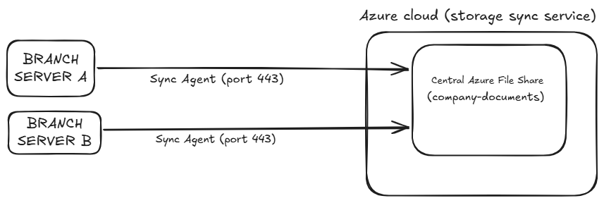

# Azure File Sync: Hybrid Storage & Cross-Site Replication Lab

## 📌 Project Overview
This project demonstrates the deployment of a fully functional hybrid storage solution using **Azure Files** and **Azure File Sync**. I built a multi-site replication environment linking on-premises infrastructure (simulated via Azure Virtual Machines) to a centralized cloud file share hub. The architecture enables local LAN performance for end-users while seamlessly synchronizing data to the cloud.

---

## 🛠️ Technologies & Services Used
* **Cloud Platform:** Microsoft Azure
* **Storage Services:** Azure Storage Accounts, Azure File Shares
* **Hybrid Connectivity:** Azure File Sync, Storage Sync Service
* **Compute:** Windows Server 2022 Virtual Machines (simulated branch offices)
* **Networking & Security:** Windows Defender Firewall, Advanced Security Policies, SMB over LAN

---

## 📐 Architecture & Data Flow
1. **The Users:** Map network drives locally to the physical file server via private IP over the LAN.
2. **The Server:** Hosts local NTFS-secured folders and runs the background *Azure File Sync Agent*.
3. **The Sync Highway:** The agent monitors local changes and securely streams data via **Port 443 (HTTPS)** to the cloud.
4. **The Central Hub:** **Azure File Share** acts as the definitive Cloud Endpoint, syncing changes back down to other registered servers.

---

## 🚀 Step-by-Step Deployment Guide

### Phase 1: Cloud Infrastructure Setup
* **Storage Architecture:** Deployed a General Purpose v2 Azure Storage Account and provisioned an Azure File Share named `company-documents` to serve as the global **Cloud Endpoint**.
* **Control Plane:** Deployed an Azure **Storage Sync Service** to manage topology and orchestration.

### Phase 2: Simulating On-Premises Branch Offices
* Deployed **two distinct Windows Server Virtual Machines** to simulate isolated geographical branch offices.
* Connected to each VM via RDP, initialized dedicated data volumes, and constructed standard corporate directory trees.

### Phase 3: Agent Installation & Registration
* Downloaded and installed the **Azure File Sync Agent** on both Windows Servers.
* Authenticated and executed the server registration wizard, securely linking both physical compute instances to the centralized **Storage Sync Service** in the cloud.

### Phase 4: Sync Topology Configuration
* Created a unified **Sync Group** in the Azure Portal focused around the `company-documents` cloud share.
* Registered both servers as distinct **Server Endpoints** mapping to their respective local physical paths (e.g., `D:\CompanyDocs`).

---

## 🛠️ Real-World Troubleshooting & Challenges

### 🛑 The Issue: Firewall Blockage (Port 445 / SMB)
During local validation, network drive mapping via private IP failed to connect, resulting in network timeout errors. 

### 🟢 The Resolution: Local Security Policy Modification
Windows Defender Firewall was actively blocking incoming SMB requests. I resolved this by:
1. Navigating to **Windows Defender Firewall with Advanced Security** on the host file servers.
2. Configuring an Inbound Rule policy to explicitly **Allow Apps** and toggle file-and-printer sharing capabilities.
3. Successfully establishing the handshake, allowing client machines to seamlessly discover and map network drives via local IP.

---

## 🧪 Validation & Results
* **Bidirectional Sync:** Creating or altering text documents on Server A successfully triggered the agent, updating the central Azure File Share and instantly replicating the changes down to Server B.
* **Permission Integrity:** Validated that local NTFS security descriptors and folder Access Control Lists (ACLs) were securely preserved across the entire sync loop.

---

## 💰 Cost Optimization & Clean-up
To align with enterprise cloud governance and avoid unnecessary subscription charges, **all deployed resources (Virtual Machines, Storage Accounts, and Sync Services) were systematically de-provisioned and deleted** immediately following successful verification.
